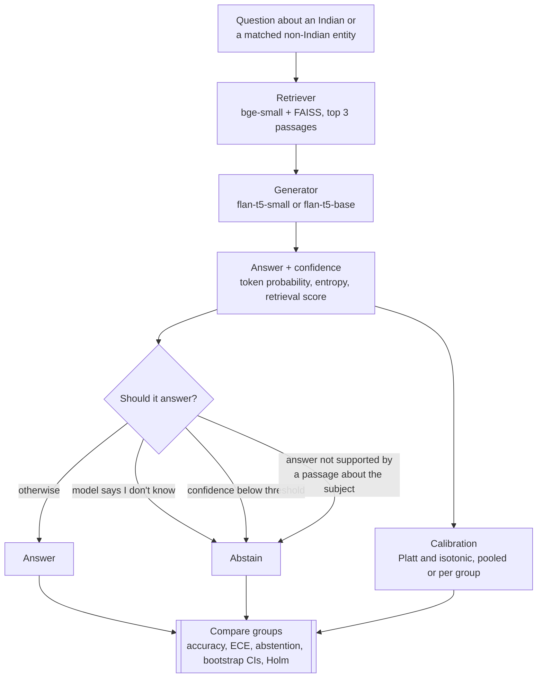

# RAG Calibration

<p>
  
  
  
  
  
</p>

<p><b>Is a small retrieval-augmented model equally reliable on questions about Indian and non-Indian entities, and does it know when to say "I don't know"?</b></p>

## At a glance

| flan-t5-small | Indian | Non-Indian |
|:--|:--:|:--:|
| Accuracy on answerable questions | 89.2% | 93.6% |
| Calibration error (ECE) | **0.209** | **0.102** |
| ECE after shared Platt scaling | 0.066 | 0.069 |
| Answered an unanswerable question | 90.2% | 77.5% |
| Same, with the grounding check | **3.7%** | **5.0%** |

- The small model is **about twice as overconfident on Indian entities**, the only gap that survives correction for multiple comparisons (ECE +0.106, 95% CI 0.043 to 0.164, Holm-adjusted p = 0.022).
- **One shared calibration closes it**, and a **label-free grounding check** cuts answers to unanswerable questions from 84% to 4.3% while keeping every correct answer.
- A **few-shot "I don't know" prompt backfires** on the small model; a **larger model** removes the accuracy gap.
- **Spelling variants** (Mysore for Mysuru) remain a weak spot, and they fall mostly on Indian names.

<p align="center">
  
</p>

## How it works



## Research questions

1. **Accuracy and retrieval.** Does the system answer questions about Indian entities as accurately as matched questions about non-Indian entities, and does the retriever find the right document equally often?
2. **Calibration.** When the system answers, is its confidence equally trustworthy for both groups? Does post-hoc calibration close any gap, and does it need to be fitted per group?
3. **Abstention.** When the answer is not in the documents, does the system abstain? Which abstention policy works best: the model's own "I don't know", a confidence threshold, or a check that the answer is supported by the retrieved text? Does one threshold treat both groups fairly?
4. **Spelling variants.** How much does performance drop when the question uses another spelling or an older name (Mysore for Mysuru), which is far more common for Indian entities?

## Results in detail

Three runs on the 628 main questions: `flan-t5-small` with the default prompt, `flan-t5-small` with the few-shot prompt, and `flan-t5-base` with the default prompt. The retriever found the right document for every answerable question in all three runs, so the differences below come from the generator and the confidence scores, not from retrieval.

### Headline numbers

| | small | small, few-shot | base |
|---|---|---|---|
| Accuracy, Indian | 89.2% | 92.7% | 100% |
| Accuracy, non-Indian | 93.6% | 96.2% | 100% |
| Answered an unanswerable question, Indian | 90.2% | 100% | 36.6% |
| Answered an unanswerable question, non-Indian | 77.5% | 100% | 35.0% |
| ECE (max_prob), Indian | 0.209 | 0.213 | 0.079 |
| ECE (max_prob), non-Indian | 0.102 | 0.141 | 0.035 |

### 1. The small model is more overconfident on Indian entities

With `flan-t5-small`, calibration error on answered questions is about twice as high for Indian entities (ECE 0.209 vs 0.102). The difference, +0.106 (95% CI 0.043 to 0.164), is the only accuracy or calibration gap that stays significant after Holm correction across the 11 comparisons (adjusted p = 0.022). Overconfidence (mean confidence minus accuracy) shows the same gap. The accuracy gap (-4.4 points, CI -9.3 to +0.7) is not significant.

The small model also answered more unanswerable Indian questions (90.2% vs 77.5%, +12.7 points, CI +1.9 to +23.6), but this does not survive the correction (adjusted p = 0.12).

With `flan-t5-base` the calibration gap shrinks to +0.044 (CI -0.001 to +0.085) and is no longer significant, and accuracy is 100% for both groups.

### 2. A simple post-hoc calibration closes the gap

Platt scaling fitted on both groups together reduces ECE from 0.209 to 0.066 (Indian) and from 0.102 to 0.069 (non-Indian), leaving a gap of -0.004 (CI -0.047 to +0.044). Fitting a separate calibration per group gives similar results (0.044 vs 0.043), so for this system the group gap is a shift in overall confidence that one shared correction removes. Isotonic regression behaves the same way.

### 3. The grounding check is the most effective abstention fix, and it works equally for both groups

Utility counts +1 per correct answer and -1 per wrong answer (thresholds by 5-fold cross-validation):

| Policy (flan-t5-small) | Answered unanswerable | Correct answers kept | Accuracy among answered | Utility |
|---|---|---|---|---|
| Model's own "I don't know" | 84.0% | 100% | 73.4% | 0.446 |
| Threshold on max_prob | 46.3% | 86.9% | 81.6% | 0.465 |
| Threshold on retrieval score | 37.7% | 96.7% | 83.6% | 0.540 |
| **Grounding check** | **4.3%** | **100%** | **97.0%** | **0.658** |

The grounding check answers only when the answer appears in a retrieved sentence that also names the question's subject. It cuts answers to unanswerable questions from 84% to 4.3% while keeping every correct answer, and it works almost equally for both groups (3.7% Indian, 5.0% non-Indian). Confidence thresholds help much less: the model is confident on most wrong answers. Separate per-group thresholds do not improve fairness in a consistent way. With `flan-t5-base`, the grounding check brings answers to unanswerable questions down from 35.8% to 1.2%, with 99.6% accuracy among answered questions.

### 4. The few-shot prompt backfires for the small model

Adding a worked example of saying "I don't know" made `flan-t5-small` never abstain: it answered 100% of unanswerable questions in both groups, against 84% with the default prompt. Accuracy on answerable questions rose slightly (94.4% vs 91.4%). A small model copies the format of the example answer rather than learning when to abstain. The grounding check still brings the few-shot run down to 4.3% answered unanswerable.

### 5. A bigger model helps more than any prompt

`flan-t5-base` answers every answerable question correctly in both groups and abstains on about two thirds of unanswerable questions without any extra policy. It is also better calibrated (ECE 0.057 overall vs 0.157). The remaining group difference in calibration is small and not significant.

### 6. Spelling variants are a weak spot, and the lexical grounding check makes it worse

When a question uses another spelling or an older name (Mysore for Mysuru, Benares for Varanasi), the right document is found for only 62% of the 21 variant questions, against 100% with the main name. Accuracy falls from 100% to 62% (small) and 52% (base). The grounding check passes only 1 of the 21 variant questions, because it looks for the question's words in the document, so it would refuse most of these questions. Indian entities have more such variants in common use (15 of the 21 here), so this weakness falls mainly on Indian names. The sample is small, so these numbers are descriptive.

### Summary

On matched questions, a small RAG model is about twice as overconfident on Indian entities as on non-Indian ones, and this is the one gap that survives correction for multiple comparisons. Two cheap fixes address the main problems: shared Platt scaling removes the calibration gap, and a lexical grounding check reduces answers to unanswerable questions from 84% to about 4% for both groups without losing correct answers. A larger generator removes the accuracy gap. Spelling variants remain an open problem, and a fairer grounding check would need transliteration-aware matching.

<details>
<summary><b>Data</b></summary>

Built by `src/make_data.py` (seed 2026); full description in [data/DATA.md](data/DATA.md).

- **628 main questions,** 314 per group, in **12 matched categories:** state capitals (Indian vs US states), official languages, city to state, landmark to city, book to author, film to director, company to founder, national park to state, athlete to sport, institution to city, musician to instrument, mountain peak to state.
- **164 documents,** each holding three facts of the same category, so the generator must pick the right fact out of similar sentences.
- **Unanswerable questions:** 25% of entities per category and group have no fact anywhere (82 Indian, 80 non-Indian). The correct behaviour is to abstain.
- **Two phrasings** per category; **aliases** for answer spellings.
- **21 spelling-variant questions** (15 Indian, 6 non-Indian) as a separate stress test.

</details>

<details>
<summary><b>Method in detail</b></summary>

| Component | Choice |
|---|---|
| Retriever | `BAAI/bge-small-en-v1.5` + FAISS inner-product index, top-3 documents |
| Generator | `google/flan-t5-small` or `flan-t5-base`, greedy decoding |
| Prompts | default ("say I don't know if the context is insufficient") and few-shot (one answerable and one unanswerable worked example) |
| Confidence signals | mean max-token probability; entropy-based confidence; top-1 retrieval similarity |
| Answer matching | normalised whole-word match against the answer or any alias |

### Abstention policies

| Policy | Answers when |
|---|---|
| Model only | the model does not say "I don't know" |
| Threshold on max_prob / retrieval score | confidence is above a threshold chosen by 5-fold cross-validation |
| Per-group threshold | as above, with a separate threshold for each group (fairness check) |
| Grounding check | the answer appears in a retrieved sentence that also mentions the question's subject (no labels used) |
| Grounding + threshold | both |

Thresholds maximise utility: +1 per correct answer, -1 per wrong answer, 0 per abstention.

### Calibration

Platt scaling and isotonic regression, fitted by 5-fold cross-validation on answered questions, either on both groups together (pooled) or per group. Reported as ECE per group before and after.

### Statistics

Group differences (Indian minus non-Indian) use 1,000 bootstrap resamples for 95% confidence intervals and p-values, with Holm correction across each family of comparisons.

</details>

<details>
<summary><b>Pilot run on the first version of the data</b></summary>

A first run used an earlier, easier version of the data: 408 questions with one short document per entity. With `flan-t5-small`:

| | Indian | Non-Indian |
|---|---|---|
| Accuracy on answerable questions | 92.1% | 95.4% |
| Answered an unanswerable question | 100% | 96.1% |
| Right document retrieved | 100% | 100% |
| ECE (max_prob) | 0.191 | 0.120 |

None of the group differences was clearly different from zero (for example accuracy -3.4 points, 95% CI -9.0 to +1.9; ECE +0.071, CI -0.018 to +0.145). The clear finding was that the model almost never abstains: a confidence threshold of 0.55 left coverage at 98-99%. Retrieval was perfect because each document held a single fact, so the data was made harder and larger, and the abstention and calibration methods above were added in response.

</details>

<details>
<summary><b>Running it on Google Colab</b></summary>

```python
from google.colab import drive
drive.mount('/content/drive')
%cd /content/drive/MyDrive/rag_calibration_project
!pip install -q -r requirements.txt
!python src/build_index.py
!python src/evaluate.py --out results/predictions.json
!python src/evaluate.py --prompt fewshot --out results_fewshot/predictions.json
!python src/evaluate.py --gen-model google/flan-t5-base --out results_base/predictions.json
!python src/compare.py results results_fewshot results_base
```

On a free Colab CPU the small-model runs take roughly 3-4 minutes each and the base model roughly 10-15 minutes (the pilot run took 2 minutes for 408 questions). Each run writes its own `RESULTS.md`, tables and figures; `compare.py` puts the three side by side in `results/comparison.md`. The same steps are in `notebooks/01_run_experiment.ipynb`.

Tests, with no model download: `!python -m pytest -q tests`. They include an end-to-end run of the analysis on the real data with a toy retriever and generator.

</details>

<details>
<summary><b>Outputs and project structure</b></summary>

| File | Contents |
|---|---|
| `predictions.json` | one row per question: answer, confidences, correctness, retrieved documents and text |
| `RESULTS.md` | all tables below in one readable file |
| `summary.csv` | accuracy, abstention, retrieval, ECE, overconfidence, AURC; overall and per group |
| `group_gaps.csv` | Indian minus non-Indian with bootstrap CIs and Holm-adjusted p-values |
| `policies.csv`, `policy_gaps.csv` | every abstention policy per group, and the group gap under each |
| `calibration.csv` | ECE per group before and after each calibration method |
| `variants.csv` | spelling-variant questions against the same question with the main name |
| `by_category.csv`, `threshold_sweep.csv` | per-category results; coverage and accuracy for each threshold |
| `fig1` to `fig4` | reliability and risk-coverage, categories, abstention policies, calibration |

```
rag_calibration_project/
├── data/
│   ├── documents/        # 164 documents, three facts each
│   ├── qa_eval.json      # 628 main + 21 variant questions
│   └── DATA.md
├── src/
│   ├── make_data.py      # builds documents and questions
│   ├── build_index.py    # FAISS index
│   ├── rag_pipeline.py   # retrieval + generation (default and few-shot prompts)
│   ├── confidence.py     # confidence signals
│   ├── metrics.py        # matching, grounding check, ECE, risk-coverage, bootstrap, Holm
│   ├── evaluate.py       # inference, saves predictions, runs the analysis
│   ├── analyze.py        # policies, calibration, variants, tables, figures, RESULTS.md
│   └── compare.py        # side-by-side comparison of runs
├── tests/test_metrics.py
├── notebooks/01_run_experiment.ipynb
└── requirements.txt
```

</details>

## Limitations

- Template-based documents. They are cleaner than real web text, so absolute accuracy is an upper bound for these models; `flan-t5-base` reaches 100% on answerable questions, so this data cannot show accuracy gaps for larger models.
- One run per setting, with greedy decoding; variation comes from the questions, not from repeated runs.
- Small models chosen for free hardware.
- The design matches question type, not entity popularity. Popularity in pre-training data is a likely driver of any gap and is not measured directly.
- The grounding check is lexical. It is cheap and needs no labels, but it can reject a correct answer written differently from the document, which matters most for transliterated Indian names; the spelling-variant analysis measures this.
- Spelling-variant questions are few (21), so that analysis is descriptive.
- The official-language category compares Indian states with countries; the other 11 categories are matched at the same level.
